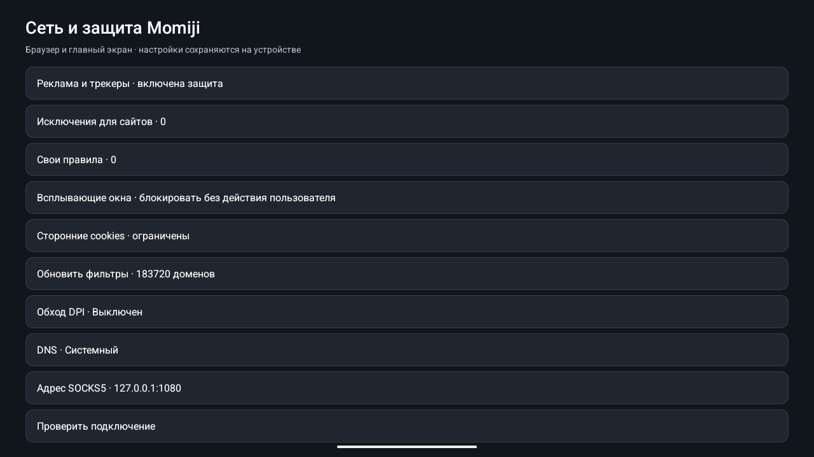

<div align="center">


# Momiji TV

**Your apps. Your screen. Your way to watch.**

A customizable Android TV home screen and a remote-friendly browser, built around local profiles, native video playback and lightweight visual effects.

[](https://github.com/MarkArtemyev/momiji-tv/actions/workflows/build.yml)


[](LICENSE)


[Download preview](https://github.com/MarkArtemyev/momiji-tv/releases) · [Русский](README.ru.md) · [Build](docs/BUILDING.md) · [Controls](docs/CONTROLS.md) · [Roadmap](docs/ROADMAP.md)

</div>


*Release preview captured in an Android 15 emulator. Installed apps and available content depend on the device.*

## One home, two companion apps

| Component | What it does | Version |
| --- | --- | --- |
| **Momiji Home** | Native launcher with profiles, categories, custom artwork and local watch history | **0.4.0** |
| **Momiji Browser** | WebView browser with remote navigation, filtering and a Media3 video player | **0.3.0** |
| **Network core** | Shared filtering, TCP/SOCKS5 routing and optional encrypted DNS | Shared source |

Both apps can run independently. Install the pair to share network settings and resume native playback from Home. Companion access requires matching APK signatures.

## Make the home screen yours

- Arrange, rename and hide applications; build your own categories and favorites.
- Give each local profile its own layout, appearance, game shortcuts and playback history.
- Choose card sizes, grid density, accent colors, fonts, corners and custom backgrounds.
- Keep app cards clean with centered icons and optional labels. Content titles stay readable.
- Turn on falling maple leaves, fireflies or stars, with per-profile speed, density and color controls.
- Tune a Mini-LED TV with presets for a dark room, a bright room and games. Home reads the panel's modes, HDR formats and brightness. It sets refresh rate, wide colour and HDR for its own window. After a one-time ADB grant, it also sets the system's frame-rate matching, HDR formats and ALLM. Each preset comes with a checklist for the TV's picture menu.
- Use a dedicated games view with gamepad detection and a shortcut to Bluetooth settings.
- Import and export layout settings without exporting history or account data.

Home uses Android Views and Canvas. Artwork loading is limited to visible cards, responses and caches are bounded, and background work is cancelled when the screen leaves the foreground. Low-RAM and reduced-motion settings are respected; atmospheric effects are off by default.

## Browse from the couch

- Switch between element focus and a free cursor for websites that need mouse-style navigation.
- Open direct supported video streams in a native Media3 player with seeking, subtitles, quality selection and playback statistics.
- With Android's frame-rate matching set to Always, the native player switches the screen to the film's own rate (24, 23.976, 25, 50 Hz…). It measures the rate when the stream does not declare it and pauses while the screen changes mode.
- Continue native playback through a profile-scoped Home history.
- Pair a computer browser over the local network for mouse, keyboard, text and playback controls.
- Keep the normal HttpEngine path for native playback when custom routing is off, using HTTP/2 or HTTP/3 when supported by the device and server.

DRM, opaque blob/MSE streams and some authenticated players still need the website's player. Local Home profiles do not switch website cookies or third-party service accounts.

## Network & protection

The shared settings screen includes offline domain filtering, contextual URL rules, cosmetic hiding, custom rules, site exceptions, popup controls and third-party cookie settings.

The browser reads the AdGuard Base, Mobile Ads, Russian and Tracking Protection lists the way the AdGuard Chromium extension does, and runs AdGuard's own open-source page engines for them:

- **Scriptlets** (AdGuard Scriptlets, AdGuard `#%#//scriptlet` and uBO `##+js` syntax) run in every frame before page scripts, without eval, so strict-CSP sites are covered too.
- **Stand-ins instead of errors**: blocked ad SDKs, VAST/VMAP, clips and pixels are answered with AdGuard's no-op resources (`$redirect`, `$redirect-rule`, plus built-in fallbacks for IMA, GPT, AdSense and analytics), so players skip straight to the video.
- **Video ads**: HLS VOD playlists lose server-inserted ad segments (SCTE-35 cues, `$hls` rules, blocked ad hosts) in web players and in the native player; JSON player APIs are cleaned with `$jsonprune`, and `$replace` rewrites VAST and scripts.
- **Popups and popunders**: `$popup` rules, plus a confirmation before a script on another site may replace the page.
- **Hiding**: element hiding, ExtendedCss (`:has-text`, `:upward`, `:remove`...), CSS injection, and the 14k generic selectors applied only for classes and ids a page really uses.

| Setting | Behavior |
| --- | --- |
| Default | Normal routing, system DNS, filtering enabled |
| TCP splitting | Changes the initial HTTPS send pattern without decrypting traffic |
| External SOCKS5 | Connects to a proxy you run yourself, including ByeDPI |
| DNS over HTTPS | Optional Cloudflare or Google resolver |
| Home coverage | Home's own artwork requests |
| Browser coverage | Website requests, supported background requests and native media requests |

No root access, interception certificate or Android VPN service is required for these network options. TCP splitting does not hide your IP or increase your connection's bandwidth. Effectiveness depends on the network; IP/protocol blocks and QUIC are not universally handled. Server-side ads stitched into live streams without markers can remain. Other apps' traffic, including the YouTube TV app, is outside the filter's scope.

<details>
<summary><strong>See network settings</strong></summary>



</details>

## Try the preview

1. Download both APKs from [Releases](https://github.com/MarkArtemyev/momiji-tv/releases).
2. Install them using Android's package installer or the explicit-device ADB commands in [Installation](docs/INSTALLATION.md).
3. Open Momiji Home, then choose apps and appearance. Keep the original launcher available while evaluating the preview.
4. Open Browser and use **Menu** for navigation, controls and **Network & protection**.

The interface is currently Russian. Android 8+ is supported by the manifests; device-specific launcher behavior, remote keys, HDMI, channels, sleep/resume and long-session performance still need validation on physical televisions. The published preview uses the existing development signing certificate. See [signing and update compatibility](docs/BUILDING.md#signing).

## Build and verify

```sh
# JDK 17+, Android SDK 35
./momiji-browser/gradlew -p momiji-browser :app:assembleRelease :app:lintDebug --max-workers=1
./momiji-home/gradlew -p momiji-home :app:assembleRelease :app:lintDebug --max-workers=1

# Pure JVM network and filter integration tests; no TV required
./momiji-browser/gradlew -p tests/network-core networkCheck --max-workers=1
```

Keep all three source directories together. [Building](docs/BUILDING.md) covers Android Studio, Windows, SDK paths, memory limits and signing. [Testing](docs/TESTING.md) records verified scenarios and the remaining hardware checks.

## Project map

```text
momiji-home/           Native launcher, profiles, appearance and artwork
momiji-browser/        Browser, PC controls and native player
momiji-network-core/   Shared networking and filtering sources
tests/network-core/   Local TLS, proxy and filtering integration suite
docs/                 Setup, controls, privacy, testing and roadmap
```

## Privacy, contributions and licenses

Profiles, settings and watch history are stored locally. There is no Momiji account requirement. Websites, filter sources, selected DNS/proxy providers and optional voice services have their own network behavior; [Privacy](PRIVACY.md) explains the boundaries and optional permissions.

Bug reports with the TV model, Android/WebView versions and reproducible steps are welcome. See [Contributing](CONTRIBUTING.md) and [Security](SECURITY.md).

Momiji TV is distributed under [GPL-3.0](LICENSE). Bundled AdGuard lists retain their licenses and source snapshots; the Public Suffix List is MPL-2.0. Credits and exact upstream sources are in [Third-party notices](THIRD_PARTY_NOTICES.md).
