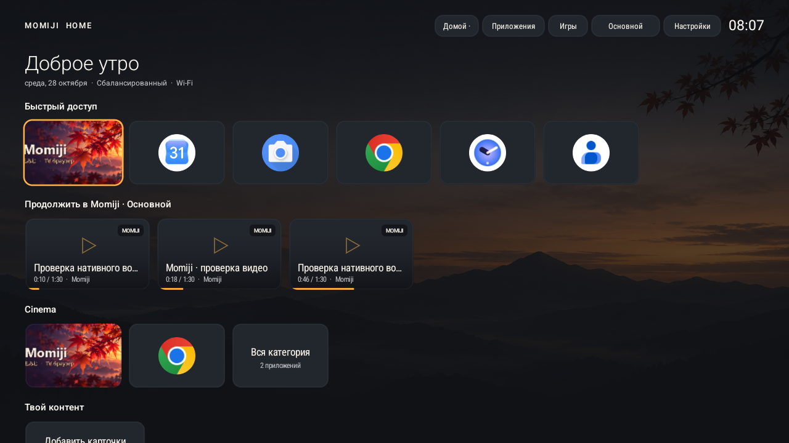

# Momiji TV

**Твои приложения. Твой экран. Твой способ смотреть.**

Настраиваемый главный экран Android TV и браузер для пульта: локальные профили, нативное видео и лёгкие визуальные эффекты.

[Скачать preview](https://github.com/MarkArtemyev/momiji-tv/releases) · [English](README.md) · [Сборка](docs/BUILDING.md) · [Управление](docs/CONTROLS.md)

## Что внутри

**Momiji Home 0.4.0** — нативный лаунчер с избранным, своими категориями, сортировкой, скрытием и переименованием приложений. У каждого локального профиля свои оформление, игровые ярлыки и история нативного плеера. Можно менять обои, карточки, сетку, шрифты и акценты, переносить оформление через JSON. Подписи под приложениями скрыты по умолчанию и возвращаются переключателем. В разделе «Экран и Mini-LED» Home показывает, что сообщает панель: режимы, частоты, HDR-форматы и яркость в нитах. Там же есть пресеты «кино в темноте», «светлая комната» и «игры». Для своего окна Home включает широкий цветовой охват, HDR для обоев Ultra HDR и максимальную бесшовную частоту. После разового разрешения по ADB он ещё и меняет системную подстройку частоты под видео, выбор HDR-форматов и ALLM, а пресет «Как в системе» всё возвращает. Локальное затемнение и подсветку приложения менять не могут, поэтому к каждому пресету есть подсказка для меню изображения ТВ.

**Momiji Browser 0.3.0** — браузер с режимами фокуса и курсора, блокировкой рекламы и нативным плеером Media3. Для прямых поддерживаемых потоков доступны перемотка, субтитры, качество и статистика. Если в Android выбрана подстройка частоты «всегда», плеер переключает экран на частоту самого фильма (24, 23,976, 25, 50 Гц…). Когда поток не сообщает частоту, плеер измеряет её по первым кадрам и ставит паузу на время переключения экрана. Компьютер можно подключить как мышь и клавиатуру через браузер в локальной сети.

**Общая защита** — офлайн-фильтры AdGuard (Base, Mobile Ads, Russian, Tracking Protection), собственные правила, исключения для сайтов, скрытие рекламы, контроль всплывающих окон и сторонних cookies. В браузере работают движки AdGuard Scriptlets и ExtendedCss: скриптлеты выполняются до скриптов страницы и без eval, поэтому работают и на сайтах со строгим CSP. Заблокированные рекламные SDK, VAST и ролики заменяются пустыми заглушками, и плеер сразу переходит к фильму. Из HLS-записей вырезаются вставленные сервером ролики, и в веб-плеерах, и в нативном плеере; JSON-ответы плееров чистятся по `$jsonprune`, VAST и скрипты правятся по `$replace`. Попандеры отсекаются правилами `$popup`, а чужой сайт должен спросить, прежде чем подменить страницу. Подключение: обычное, TCP-разбиение или свой SOCKS5/ByeDPI; DNS — системный, Cloudflare или Google по HTTPS. В Home фильтруются его изображения; в Browser — запросы страниц и нативного плеера.

## Оформление без обязательных тяжёлых эффектов

Кленовые листья, светлячки и звёзды рисуются на Canvas. Скорость, цвет и плотность сохраняются по профилям. По умолчанию атмосфера выключена; доступны экономный режим и общий выключатель эффектов. Анимация приостанавливается в фоне и учитывает системное уменьшение движения. Производительность конкретного телевизора нужно проверять отдельно.

## Установка

Скачай оба APK из [Releases](https://github.com/MarkArtemyev/momiji-tv/releases), установи и открой Home. Для обмена историей и настройками приложения должны иметь одинаковую подпись. В опубликованном комплекте она совпадает.

Это preview: проверки выполнены на эмуляторе Android 15. Плавность, нагрев, сон, HDMI, кнопки пульта и совместимость конкретной прошивки ТВ ещё требуют проверки. В сборках используется текущий сертификат разработки; самостоятельная сборка другим ключом не установится поверх APK с несовпадающей подписью.

Обычный браузерный движок — Android WebView. DRM, blob/MSE и часть авторизованных потоков остаются в веб-плеере. История относится к нативному плееру; профили Home не переключают аккаунты YouTube, cookies сайтов или пользователей Android. Системные ряды сервисов доступны только в объёме, который отдают сами сервисы и прошивка.

TCP-разбиение не скрывает IP и не увеличивает скорость тарифа. Эффект зависит от провайдера; блокировки по IP/протоколам универсально не снимаются. Реклама, бесшовно вшитая в прямой эфир без меток, может остаться. Системный трафик сторонних приложений, в том числе приложения YouTube, эти фильтры не перехватывают.

## Документация

- [Установка и выбор устройства ADB](docs/INSTALLATION.md)
- [Сборка, Android Studio и подпись](docs/BUILDING.md)
- [Пульт, компьютер и оформление](docs/CONTROLS.md)
- [Проверенные сценарии и ограничения](docs/TESTING.md)
- [Планы развития](docs/ROADMAP.md)
- [Данные и разрешения](PRIVACY.md)
- [Лицензии и источники фильтров](THIRD_PARTY_NOTICES.md)

Исходники распространяются под GPL-3.0. Лицензии сторонних данных сохранены отдельно.
